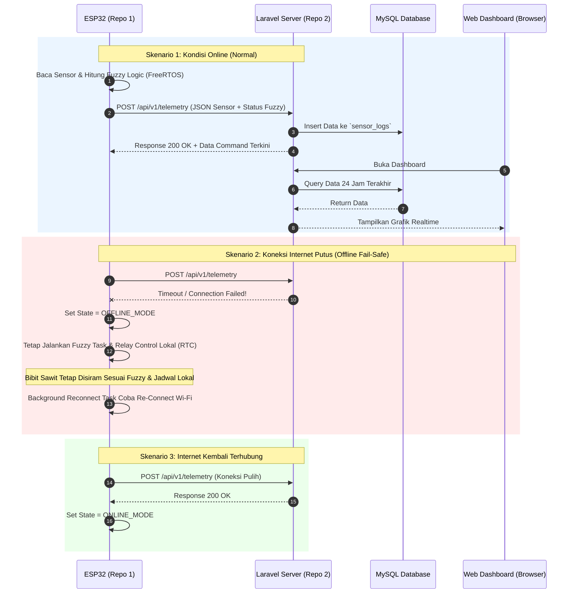

# Panduan Migrasi Architecture & Sistem Hybrid Smart Oil Palm Nursery

Dokumen ini berisi panduan komprehensif alur migrasi sistem **Smart Oil Palm Nursery** dari sistem lokal (ESP32 Standalone Web Server) menuju arsitektur **Hybrid Cloud Hosting & Database (Laravel + MySQL)** dengan fitur **Offline Fail-Safe Auto-Mode**.

---

## 1. Konsep Utama Sistem Hybrid

Sistem dirancang dengan arsitektur **Hybrid Resilience (Tahan Gagal Koneksi)**:

```
                  ┌─────────────────────────────────────────┐
                  │          ESP32 Controller               │
                  │   (Fuzzy Logic & RTC DS3231 Lokal)     │
                  └────────────────────┬────────────────────┘
                                       │
                  ┌────────────────────┴────────────────────┐
                  │     Cek Koneksi Internet / Wi-Fi        │
                  └──────────┬───────────────────┬──────────┘
                             │                   │
                     [ Ada Internet ]     [ Internet Putus ]
                             │                   │
                             ▼                   ▼
           ┌───────────────────────────┐ ┌───────────────────────────┐
           │    SINKRONISASI CLOUD     │ │      STANDALONE MODE      │
           ├───────────────────────────┤ ├───────────────────────────┤
           │ 1. Kirim data sensor ke   │ │ 1. Fuzzy Logic & RTC tetap│
           │    Laravel MySQL DB.      │ │    berjalan lokal.        │
           │ 2. Ambil perintah control │ │ 2. Penyiraman otomatis    │
           │    dari Web Dashboard.    │ │    berjalan tanpa henti.  │
           └───────────────────────────┘ └───────────────────────────┘
```

### Skenario Kondisi Operasional:
1. **Saat Internet Terhubung (Online Mode)**:
   * ESP32 rutin mengirimkan telemetry data sensor & log penyiraman ke Laravel (setiap 5-10 detik).
   * ESP32 mengecek apakah ada perintah manual (*Override*) atau perubahan jadwal dari Web Dashboard Laravel.
   * User dapat melihat grafik sensor & mengontrol relay dari mana saja via internet.

2. **Saat Internet / Wi-Fi Putus (Offline / Fail-Safe Mode)**:
   * ESP32 mendeteksi hilangnya koneksi internet (`WiFi.status() != WL_CONNECTED` atau HTTP Timeout).
   * ESP32 **TIDAK AKAN CRASH ATAU BERHENTI**. ESP32 beralih ke mode **Lokal Independen**.
   * Algoritma **Fuzzy Logic & RTC DS3231** di ESP32 tetap mengeksekusi penyiraman otomatis untuk 5 zona bibit sawit secara tepat waktu.
   * Sistem mengabaikan request HTTP cloud sementara dan mencoba melakukan re-koneksi (*Auto-Reconnect*) di background tanpa mengganggu FreeRTOS tasks lainnya.

3. **Saat Internet Terhubung Kembali (Re-connected)**:
   * ESP32 otomatis menyadari internet telah aktif kembali.
   * ESP32 melanjutkan pengiriman data sensor terbaru ke Laravel Cloud secara otomatis.

---

## 2. Struktur Repository Git (Pemisahan 2 Repo)

Untuk kerapihan deployment dan kemudahan pengelolaan versi, proyek dibagi menjadi **2 Repository GitHub terpisah**:

### Repo 1: Firmware ESP32 (`smart-nursery-firmware`)
* **Teknologi**: C++, PlatformIO, FreeRTOS, ArduinoJson, HTTPClient.
* **Tugas**: Membaca sensor, menghitung Fuzzy Logic, mengontrol Relay, dan menangani HTTP Client ke Laravel.
* **Struktur Folder**:
  ```text
  smart-nursery-firmware/
  ├── include/
  ├── lib/
  ├── src/
  │   └── main.cpp           <-- Logika Utama ESP32 & FreeRTOS Tasks
  └── platformio.ini         <-- Config Board & Dependencies
  ```

### Repo 2: Web Application & API (`smart-nursery-web`)
* **Teknologi**: PHP (Laravel 10/11), MySQL Database, Blade UI / Tailwind CSS, Chart.js.
* **Tugas**: Menyediakan Web Dashboard publik, menyimpan histori data ke Database MySQL, dan menyediakan REST API untuk ESP32.
* **Struktur Folder**:
  ```text
  smart-nursery-web/
  ├── app/
  │   ├── Http/Controllers/Api/  <-- TelemetryController & CommandController
  │   └── Models/               <-- SensorLog, ZoneStatus, DeviceControl
  ├── database/migrations/       <-- Skema Tabel Database MySQL
  ├── routes/
  │   ├── api.php                <-- Endpoint REST API untuk ESP32
  │   └── web.php                <-- Route Dashboard Web User
  └── resources/views/           <-- Halaman Dashboard Web
  ```

---

## 3. Diagram Alur Data Komunikasi (Sequence Diagram)



---

## 4. Rancangan Database MySQL (Laravel Migrations)

### A. Tabel `sensor_logs`
Menyimpan riwayat pembacaan sensor dan kondisi lingkungan nursery.
| Column | Type | Description |
| :--- | :--- | :--- |
| `id` | BigInt (PK, Auto) | ID Log |
| `temperature` | Float | Suhu Udara (°C) |
| `humidity` | Float | Kelembaban Udara (%) |
| `light_level` | Int | Intensitas Cahaya (Lux) |
| `created_at` | Timestamp | Waktu Data Dicatat |

### B. Tabel `zone_logs`
Menyimpan kondisi soil moisture & output fuzzy penyiraman tiap zona (5 Zona).
| Column | Type | Description |
| :--- | :--- | :--- |
| `id` | BigInt (PK, Auto) | ID Log Zona |
| `sensor_log_id` | BigInt (FK) | Foreign Key ke `sensor_logs` |
| `zone_id` | TinyInt | Nomor Zona (1 - 5) |
| `soil_moisture` | Int | Kelembaban Tanah (%) |
| `fuzzy_duration` | Int | Durasi Penyiraman Fuzzy (Detik) |
| `relay_status` | Boolean | Status Relay Valve (ON/OFF) |

### C. Tabel `device_controls`
Menyimpan konfigurasi mode & perintah manual override dari Web Dashboard ke ESP32.
| Column | Type | Description |
| :--- | :--- | :--- |
| `id` | BigInt (PK) | ID Device |
| `device_key` | String | Key Identifier ESP32 |
| `system_mode` | TinyInt | `0` = AUTO (Fuzzy), `1` = MANUAL (Override) |
| `manual_pump` | Boolean | Override Pompa Utama (ON/OFF) |
| `manual_zone_1` | Boolean | Override Valve Zona 1 (ON/OFF) |
| `manual_zone_2` | Boolean | Override Valve Zona 2 (ON/OFF) |
| `manual_zone_3` | Boolean | Override Valve Zona 3 (ON/OFF) |
| `manual_zone_4` | Boolean | Override Valve Zona 4 (ON/OFF) |
| `manual_zone_5` | Boolean | Override Valve Zona 5 (ON/OFF) |
| `updated_at` | Timestamp | Waktu Perintah Diubah User |

---

## 5. Kontrak API (API Endpoints JSON)

### 1. `POST /api/v1/telemetry` (ESP32 $\rightarrow$ Laravel)
**Header**: `Content-Type: application/json`, `X-API-KEY: your_secret_key`

**Request Body**:
```json
{
  "api_key": "nursery_secret_123",
  "temperature": 31.2,
  "humidity": 76.5,
  "light_level": 1400,
  "zones": [
    {"zone_id": 1, "soil": 40, "fuzzy_duration": 25, "relay_state": 1},
    {"zone_id": 2, "soil": 65, "fuzzy_duration": 0, "relay_state": 0},
    {"zone_id": 3, "soil": 72, "fuzzy_duration": 0, "relay_state": 0},
    {"zone_id": 4, "soil": 58, "fuzzy_duration": 0, "relay_state": 0},
    {"zone_id": 5, "soil": 61, "fuzzy_duration": 0, "relay_state": 0}
  ]
}
```

**Response 200 OK**:
```json
{
  "status": "success",
  "message": "Telemetry data stored",
  "command": {
    "system_mode": 0,
    "override_relays": [0, 0, 0, 0, 0]
  }
}
```

---

## 6. Penyesuaian Kode ESP32 (`src/main.cpp`)

Pada proyek PlatformIO, struktur tugas Web Server lokal diganti dengan **CloudSyncTask** yang aman terhadap hilangnya koneksi:

```cpp
#include <WiFi.h>
#include <HTTPClient.h>
#include <ArduinoJson.h>

const char* serverApiUrl = "https://domain-anda.com/api/v1/telemetry";
const char* apiKey = "nursery_secret_123";

void CloudSyncTask(void *pvParameters) {
  for (;;) {
    if (WiFi.status() == WL_CONNECTED) {
      HTTPClient http;
      http.begin(serverApiUrl);
      http.addHeader("Content-Type", "application/json");
      http.addHeader("X-API-KEY", apiKey);

      // 1. Susun JSON dari variabel global sensor & zone state
      JsonDocument doc;
      doc["api_key"] = apiKey;
      doc["temperature"] = temperature;
      doc["humidity"] = humidity;
      doc["light_level"] = lightLevel;

      JsonArray zonesArr = doc["zones"].to<JsonArray>();
      for (int i = 0; i < 5; i++) {
        JsonObject z = zonesArr.add<JsonObject>();
        z["zone_id"] = i + 1;
        z["soil"] = zona[i].soil;
        z["fuzzy_duration"] = zona[i].duration;
        z["relay_state"] = manualRelayState[i];
      }

      String jsonPayload;
      serializeJson(doc, jsonPayload);

      // 2. Kirim POST HTTP ke Cloud
      int httpCode = http.POST(jsonPayload);

      if (httpCode == HTTP_CODE_OK) {
        String response = http.getString();
        // Parse perintah manual dari Response Laravel (jika ada)
        JsonDocument resDoc;
        if (!deserializeJson(resDoc, response)) {
          int mode = resDoc["command"]["system_mode"];
          if (mode == 1) { // Manual Mode dari Web Dashboard
             // Set variabel mode lokal
             systemMode = 1;
          } else {
             systemMode = 0; // Auto Fuzzy Mode
          }
        }
      } else {
        Serial.printf("[CloudSync] HTTP Error: %d\n", httpCode);
      }
      http.end();
    } else {
      Serial.println("[CloudSync] Wi-Fi Terputus! Berjalan dalam Standalone Mode.");
    }

    // Interval Sinkronisasi Cloud (Misal tiap 5 detik)
    vTaskDelay(pdMS_TO_TICKS(5000));
  }
}
```

---

## 7. Tahapan Langkah Eksekusi (Roadmap Implementation)

1. **Langkah 1: Setup Repository & Inisialisasi Project Laravel (Repo 2)**
   * Inisialisasi repo `smart-nursery-web`.
   * Buat migration tabel database `sensor_logs`, `zone_logs`, dan `device_controls`.
   * Buat API Controllers untuk menerima POST data dari ESP32.

2. **Langkah 2: Deployment Laravel ke Hosting**
   * Upload Laravel ke Cloud Hosting / VPS dengan domain (misal `https://smartnursery-telu.com`).
   * Konfigurasi `.env` database MySQL di hosting.
   * Pastikan SSL Active (`https://`).

3. **Langkah 3: Modifikasi Firmware PlatformIO ESP32 (Repo 1)**
   * Hapus dependensi local `WebServer` & `SPIFFS` serving.
   * Tambahkan task `CloudSyncTask` dengan `HTTPClient.h` di `main.cpp`.
   * Uji coba pengiriman telemetry saat Wi-Fi terhubung dan saat Wi-Fi dimatikan (uji coba fail-safe).

4. **Langkah 4: Pembuatan Dashboard Web Laravel UI**
   * Buat grafik sensor realtime (Chart.js / ApexCharts).
   * Buat tombol toggle saklar relay manual & ubah mode Auto/Manual.

5. **Langkah 5: Integration Testing**
   * Uji coba akhir sistem secara penuh dari bibit sawit fisik di lapangan hingga tampilan dashboard di HP via internet.
