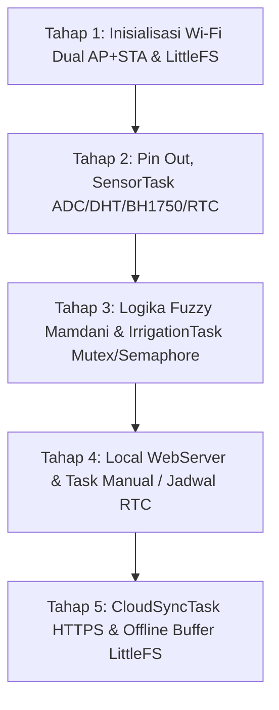

# Rencana Implementasi Migrasi Arsitektur Hosting Hybrid ESP32 (Modul Bertahap)

Rencana ini membagi implementasi firmware ESP32 di [src/main.cpp](file:///c:/FIRMWARE_TA/src/main.cpp) menjadi **5 tahap inkremental (satu per satu)** agar setiap komponen dapat dikompilasi dan diverifikasi tanpa error.

---

## 💡 Penjelasan Pertanyaan User: Apa itu `device_key`?

`device_key` (atau Device Identifier) adalah **kunci unik (string ID)** yang dikirim oleh ESP32 dalam setiap HTTP Request header (`X-Device-Token`) atau JSON payload ke server Laravel Hosting. 
* **Fungsinya**: Agar server Laravel yang di-host di `https://smartnursery-tel-u.srs-ssms.com/` tahu secara persis perangkat ESP32 nursery mana yang sedang mengirim data sensor atau meminta status perintah penyiraman (misal ID Perangkat: `"NURSERY_01"`).

---

## ⚙️ Konfigurasi Final Terverifikasi

1. **URL Hosting Cloud**:
   - Live URL: `https://smartnursery-tel-u.srs-ssms.com/`
   - Telemetry API: `https://smartnursery-tel-u.srs-ssms.com/api/v1/telemetry`
   - Batch Sync API: `https://smartnursery-tel-u.srs-ssms.com/api/v1/telemetry/sync-batch`
2. **Kredensial Wi-Fi**:
   - SoftAP SSID: `"SmartNursery-TelU"`
   - SoftAP Password: `"admin123"`
   - STA Router SSID: `"IT_SRS"`
   - STA Router Password: `"SRS@2026"`
3. **Filesystem**: **`LittleFS`** (menggantikan SPIFFS).
4. **Hardware Pins (`main_cpp.bak`)**:
   - Soil ADC: `1, 2, 3, 6, 7`
   - DHT22: `GPIO 4`
   - Relay Main: `GPIO 13`
   - Relay 5 Zona: `GPIO 15, 18, 14, 5, 27` (Active LOW)
   - I2C (RTC DS3231 & BH1750): Default I2C Wire

---

## 🛠️ Tahapan Eksekusi Inkremetal (Satu per Satu)



### **Tahap 1: Setup Dasar, Dual Wi-Fi (AP + STA), & LittleFS**
- **Tujuan**: Membuat kerangka `main.cpp` awal yang berhasil mounting `LittleFS`, menyalakan Access Point `SmartNursery-TelU` (pass: `admin123`), serta melakukan percobaan koneksi STA ke router `IT_SRS`.
- **Verifikasi**: Build PlatformIO (`pio run`) untuk memastikan Wi-Fi & LittleFS terkompilasi bersih.

### **Tahap 2: Definisi Pin Hardware & SensorTask**
- **Tujuan**: Menambahkan konfigurasi pin, regresi linier soil moisture (`Y = 41.7453982 + (-0.012665492 * adc)`), pembacaan DHT22, BH1750, dan RTC DS3231 ke dalam `SensorTask` FreeRTOS.
- **Verifikasi**: Build PlatformIO (`pio run`).

### **Tahap 3: Logika Fuzzy Mamdani & Irrigation Tasks**
- **Tujuan**: Memindahkan 19 rule Fuzzy Mamdani, proteksi cooldown 4 jam, `zonaMutex`, dan `maxConcurrentIrrigationSemaphore` (maksimal 3 relay aktif simultan) ke `FuzzyTask` & `IrrigationTask`.
- **Verifikasi**: Build PlatformIO (`pio run`).

### **Tahap 4: Local WebServer & Manual / Schedule Tasks**
- **Tujuan**: Menambahkan endpoint REST lokal di `192.168.4.1` (seperti `/api/data`, `/api/override`, `/api/relay`, `/api/config`, `/api/schedule`, `/api/log`), `ManualControlTask`, `ScheduleTask`, dan `MemoryTask` dengan penyimpanan `LittleFS`.
- **Verifikasi**: Build PlatformIO (`pio run`).

### **Tahap 5: CloudSyncTask (HTTPS HTTPS Client & Offline Buffer LittleFS)**
- **Tujuan**: Mengaktifkan sinkronisasi telemetry HTTPS POST ke `https://smartnursery-tel-u.srs-ssms.com/api/v1/telemetry`, pengolahan JSON response perintah dari Laravel, serta buffer penyimpanan offline di LittleFS (`/offline_q.json`) saat internet putus.
- **Verifikasi**: Build PlatformIO (`pio run`).

---

## Verification Plan

### Automated Build Verification
Setelah menyelesaikan setiap tahap, jalankan command build PlatformIO untuk memastikan tidak ada error syntax maupun error linker:
```powershell
pio run
```
